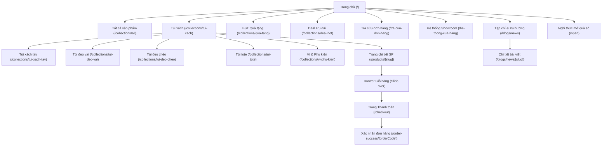
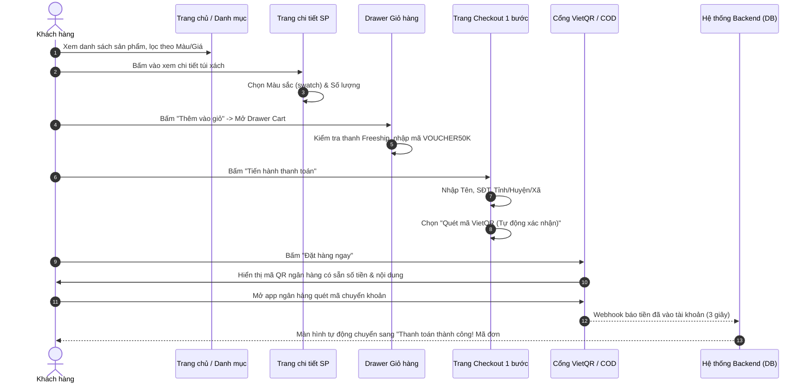

# 4. Kiến trúc Website & Cấu trúc Định tuyến Next.js (Site Architecture)

Tài liệu này chi tiết hóa bản đồ trang web (Sitemap), cây thư mục định tuyến của Next.js 15 App Router, và luồng di chuyển người dùng (User Flows) qua các màn hình chính.

---

## 1. Bản đồ Trang Web (Sitemap Overview)



---

## 2. Cấu trúc Cây Thư mục Next.js 15 (App Router Structure)

Dự án được phân chia theo kiến trúc Route Groups để tối ưu layout riêng cho từng cụm chức năng (Shop, Checkout, Admin, Account):

```
c:\Users\hoang\Documents\Code\lis\
├── app/
│   ├── (shop)/                         # Nhóm layout chính của cửa hàng (Header + Footer đầy đủ)
│   │   ├── layout.tsx                  # Layout dùng chung cho toàn bộ shop
│   │   ├── page.tsx                    # Trang chủ (Homepage với 9 sections)
│   │   ├── collections/
│   │   │   ├── [slug]/
│   │   │   │   ├── page.tsx            # Trang danh mục & bộ lọc sản phẩm (Faceted Filtering)
│   │   │   │   └── loading.tsx         # Skeleton loader danh mục
│   │   │   └── page.tsx                # Chuyển hướng hoặc hiển thị danh sách tất cả BST
│   │   ├── products/
│   │   │   └── [slug]/
│   │   │       ├── page.tsx            # Trang chi tiết sản phẩm (PDP)
│   │   │       ├── opengraph-image.tsx # Sinh ảnh thumbnail chia sẻ Facebook/Zalo tự động
│   │   │       └── loading.tsx         # Skeleton loader chi tiết sản phẩm
│   │   ├── blogs/
│   │   │   ├── page.tsx                # Trang danh sách bài viết
│   │   │   └── [slug]/
│   │   │       └── page.tsx            # Nội dung bài viết blog / lookbook
│   │   ├── he-thong-cua-hang/
│   │   │   └── page.tsx                # Bản đồ & danh sách showroom
│   │   ├── tra-cuu-don-hang/
│   │   │   └── page.tsx                # Tra cứu vận đơn bằng SĐT hoặc Mã đơn
│   │   ├── chinh-sach/
│   │   │   └── [slug]/page.tsx         # Trang chính sách đổi trả, bảo hành, bảo mật
│   │   └── open/                       # Kế thừa module mở quà số từ LIS
│   │       └── page.tsx                # Nhập mã 6 số mở thiệp điện tử [Phase 3]
│   │
│   ├── (checkout)/                     # [Phase 2] Nhóm layout thanh toán độc lập (Tối giản, tránh xao nhãng)
│   │   ├── layout.tsx                  # Header rút gọn chỉ có Logo + Hotline, không có Menu
│   │   ├── checkout/
│   │   │   └── page.tsx                # Form thanh toán 1 trang (1-Page Checkout)
│   │   └── order-success/
│   │       └── [orderCode]/
│   │           └── page.tsx            # Trang chúc mừng đặt hàng + Mã VietQR thanh toán
│   │
│   ├── (account)/                      # [Phase 3] Nhóm layout tài khoản người dùng
│   │   ├── layout.tsx
│   │   ├── account/
│   │   │   ├── login/page.tsx          # Đăng nhập (OTP SMS / Email)
│   │   │   ├── register/page.tsx       # Đăng ký thành viên
│   │   │   ├── orders/page.tsx         # Lịch sử đơn hàng
│   │   │   └── profile/page.tsx        # Cập nhật thông tin cá nhân & sổ địa chỉ
│   │
│   ├── (admin)/                        # [Phase 3] Trang quản trị dành riêng cho chủ shop
│   │   ├── admin/
│   │   │   ├── dashboard/page.tsx      # Thống kê doanh thu, đơn hàng
│   │   │   ├── products/page.tsx       # Danh sách, thêm mới, sửa sản phẩm
│   │   │   ├── orders/page.tsx         # Quản lý đơn hàng & xuất vận đơn
│   │   │   ├── discounts/page.tsx      # Quản lý mã giảm giá
│   │   │   └── stores/page.tsx         # Cập nhật hệ thống showroom
│   │
│   ├── api/                            # Route Handlers phục vụ dữ liệu & Webhook
│   │   ├── products/route.ts           # [Phase 1] Lọc sản phẩm
│   │   ├── collections/route.ts        # [Phase 1] Danh mục
│   │   ├── cart/route.ts               # [Phase 1] Kiểm tra tồn kho giỏ hàng
│   │   ├── checkout/route.ts           # [Phase 2] Xử lý đơn hàng
│   │   ├── shipping/fee/route.ts       # [Phase 2] Tính phí ship GHN/GHTK
│   │   ├── payments/
│   │   │   ├── vietqr/webhook/route.ts # [Phase 2] Webhook xác nhận chuyển khoản PayOS
│   │   │   └── vnpay/return/route.ts   # [Phase 2] Return URL VNPay
│   │   └── tracking/route.ts           # [Phase 3] Tra cứu vận đơn realtime
│   │
│   ├── global.css                      # Tailwind v4 directives & custom tokens
│   ├── layout.tsx                      # Root layout (Metadata, Google Fonts, Providers)
│   ├── sitemap.ts                      # Sinh sitemap.xml động
│   └── robots.ts                       # Cấu hình robots.txt chuẩn SEO
│
├── components/                         # Thư viện UI Components tái sử dụng
│   ├── common/                         # Button, Input, Modal, Drawer, Badge, Accordion
│   ├── header/                         # Navbar, MegaMenu, MobileMenu, SearchModal
│   ├── footer/                         # FooterLinks, NewsletterForm, SocialIcons
│   ├── product/                        # ProductCard, ProductGrid, SwatchPicker, QuickView
│   ├── pdp/                            # GallerySlider, VariantSelector, SizeGuideModal, StickyCTA
│   ├── cart/                           # CartDrawer, CartItem, FreeshipProgress, VoucherInput
│   ├── checkout/                       # AddressSelector, PaymentMethodList, OrderSummary
│   └── home/                           # HeroBanner, BestSellers, BagCategories, BrandStory
│
├── lib/                                # Các tiện ích dùng chung & kết nối bên ngoài
│   ├── prisma.ts                       # Prisma Client singleton
│   ├── utils.ts                        # Format giá VND, format ngày tháng, slugify
│   ├── ghn.ts                          # API Giao Hàng Nhanh
│   └── payos.ts                        # API Cổng VietQR PayOS
```

---

## 3. Chi tiết Bố cục 9 Sections trên Trang Chủ (Homepage Layout)

| Thứ tự Section | Tên Section | Mục tiêu nghiệp vụ & Bố cục |
|---|---|---|
| **0** | **Top Announcement Bar** | Dòng chữ chạy hoặc chuyển động mượt: "Miễn phí vận chuyển toàn quốc cho đơn từ 500k • Đổi hàng miễn phí trong 14 ngày". |
| **1** | **Hero Banner (Video/Slider)** | Video quay người mẫu mang túi xách thời thượng (autoplay, muted, loop) hoặc Slider 3 ảnh phân giải cao kèm nút CTA: "Khám phá BST Mới". |
| **2** | **Bộ sưu tập Nổi bật (Featured)** | Lưới 2 ảnh lớn phong cách Lookbook: 1 bên là "ĐƯỢC YÊU THÍCH NHẤT", 1 bên là "SET QUÀ TẶNG THỜI THƯỢNG". |
| **3** | **Dáng túi bạn cần (Bag Silhouettes)** | Slider tab chuyển đổi trực tiếp: Túi Xách Tay / Túi Đeo Vai / Túi Đeo Chéo / Túi Tote. Khách bấm tab nào lập tức hiển thị carousel 8 sản phẩm tiêu biểu của dáng đó. |
| **4** | **Sản phẩm Mới cập nhật (New Arrivals)**| Lưới 8 sản phẩm mới nhất kèm nhãn `NEW`, hỗ trợ nút "Xem tất cả sản phẩm mới" dẫn về danh mục. |
| **5** | **The Making of a Bag (Brand Story)** | Khung hình chữ nhật lớn phong cách tạp chí thời trang, video tư liệu ngắn mô tả quá trình cắt da, may chỉ thủ công và kiểm định khóa kéo kim loại. |
| **6** | **Cam kết thương hiệu (Brand Values)** | 4 khối icon thanh lịch: 1. Da PU & Da thật chọn lọc; 2. Đổi trả 14 ngày an tâm; 3. Đồng kiểm khi nhận hàng; 4. Đóng hộp quà cao cấp chuẩn chỉnh. |
| **7** | **Bạn thân Thương hiệu (Social UGC)** | Lưới 6 ảnh từ Instagram/TikTok của các khách hàng và KOLs diện túi. Nhấn vào ảnh mở popup xem túi khách đang đeo và nút mua ngay. |
| **8** | **Hệ thống Cửa hàng & Newsletter** | Bản đồ thu nhỏ dẫn link tới danh sách showroom + Form nhập email nhận voucher giảm 10% cho đơn hàng đầu tiên. |
| **9** | **Footer Đẳng cấp** | Thông tin công ty đầy đủ, giấy phép ĐKKD, logo Đã thông báo Bộ Công Thương, danh sách ngân hàng & phương thức thanh toán hỗ trợ. |

---

## 4. Luồng Người dùng Mua hàng (User Purchase Flow)


