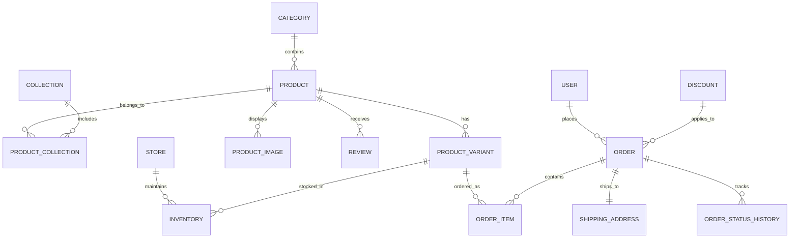

# 5. Thiết kế Mô hình Dữ liệu (Database Schema & Data Modeling)

Tài liệu này định nghĩa lược đồ cơ sở dữ liệu quan hệ (Relational Database Schema) sử dụng **Prisma ORM** với cơ sở dữ liệu **PostgreSQL** (có thể triển khai trên Neon Serverless Postgres, Supabase, hoặc AWS RDS). Schema được thiết kế chuẩn hóa, hỗ trợ biến thể phức tạp (nhiều màu, nhiều size), theo dõi tồn kho theo từng showroom, quản lý khuyến mại và đơn hàng chuẩn thương mại điện tử.

---

## 1. Sơ đồ Thực thể Quan hệ (ER Diagram Tổng quan)



---

## 2. Prisma Schema Chi tiết (`prisma/schema.prisma`)

```prisma
datasource db {
  provider = "postgresql"
  url      = env("DATABASE_URL")
}

generator client {
  provider = "prisma-client-js"
}

// --------------------------------------------------------
// 1. NGƯỜI DÙNG & PHÂN QUYỀN
// --------------------------------------------------------

enum Role {
  CUSTOMER
  STAFF
  ADMIN
}

model User {
  id            String    @id @default(cuid())
  name          String?
  phone         String?   @unique
  email         String?   @unique
  passwordHash  String?
  role          Role      @default(CUSTOMER)
  avatarUrl     String?
  createdAt     DateTime  @default(now())
  updatedAt     DateTime  @updatedAt

  addresses     Address[]
  orders        Order[]
  reviews       Review[]
  giftMessages  GiftMessage[]

  @@index([phone])
  @@index([email])
}

model Address {
  id          String   @id @default(cuid())
  userId      String
  user        User     @relation(fields: [userId], references: [id], onDelete: Cascade)
  fullName    String
  phone       String
  province    String   // Tỉnh / Thành phố
  district    String   // Quận / Huyện
  ward        String   // Phường / Xã
  street      String   // Số nhà, tên đường
  isDefault   Boolean  @default(false)
  createdAt   DateTime @default(now())

  @@index([userId])
}

// --------------------------------------------------------
// 2. PHÂN LOẠI & BỘ SƯU TẬP
// --------------------------------------------------------

model Category {
  id          String    @id @default(cuid())
  name        String    // Túi xách tay, Túi đeo vai, Túi tote, Ví...
  slug        String    @unique
  description String?
  imageUrl    String?
  sortOrder   Int       @default(0)
  isActive    Boolean   @default(true)
  createdAt   DateTime  @default(now())

  products    Product[]

  @@index([slug])
}

model Collection {
  id          String    @id @default(cuid())
  name        String    // BST Slaymotion, Deal Sinh Nhật, Set Quà 8/3...
  slug        String    @unique
  bannerUrl   String?   // Ảnh banner lớn đầu trang
  description String?
  isFeatured  Boolean   @default(false) // Hiện trang chủ
  createdAt   DateTime  @default(now())

  products    ProductCollection[]

  @@index([slug])
}

model ProductCollection {
  productId    String
  collectionId String
  sortOrder    Int        @default(0)

  product      Product    @relation(fields: [productId], references: [id], onDelete: Cascade)
  collection   Collection @relation(fields: [collectionId], references: [id], onDelete: Cascade)

  @@id([productId, collectionId])
}

// --------------------------------------------------------
// 3. SẢN PHẨM & BIẾN THỂ
// --------------------------------------------------------

model Product {
  id             String    @id @default(cuid())
  name           String    // Tên: Túi Xách Tay Aura Size 18
  slug           String    @unique
  skuCode        String    @unique // Mã SP: TXT2512138
  categoryId     String
  category       Category  @relation(fields: [categoryId], references: [id])
  
  price          Int       // Giá bán hiện tại (VND)
  comparePrice   Int?      // Giá niêm yết cũ (để tính % giảm)
  isFeatured     Boolean   @default(false)
  isNew          Boolean   @default(true)
  isActive       Boolean   @default(true)

  // Thông số kỹ thuật chi tiết
  material       String?   // Da PU cao cấp, Da bò nhập khẩu...
  dimensions     String?   // 18 x 6 x 12 cm
  designFeatures String?   // Dáng hộp thanh lịch, khóa kéo kim loại 2 đầu...
  description    String    @db.Text
  warrantyInfo   String?   @db.Text // Chính sách bảo hành & đổi trả 14 ngày

  createdAt      DateTime  @default(now())
  updatedAt      DateTime  @updatedAt

  images         ProductImage[]
  variants       ProductVariant[]
  collections    ProductCollection[]
  reviews        Review[]

  @@index([slug])
  @@index([categoryId])
  @@index([price])
}

model ProductImage {
  id         String   @id @default(cuid())
  productId  String
  product    Product  @relation(fields: [productId], references: [id], onDelete: Cascade)
  url        String   // Link ảnh WebP/CDN
  altText    String?
  colorName  String?  // Ảnh này gắn với màu nào (ví dụ: "Kem", "Đen")
  isMain     Boolean  @default(false) // Ảnh đại diện số 1
  isHover    Boolean  @default(false) // Ảnh thứ 2 khi hover
  sortOrder  Int      @default(0)

  @@index([productId])
}

model ProductVariant {
  id            String      @id @default(cuid())
  productId     String
  product       Product     @relation(fields: [productId], references: [id], onDelete: Cascade)
  
  sku           String      @unique // TXT2512138-BLACK-18
  colorName     String      // Đen, Kem, Xanh Mint, Nâu Tan, Đỏ Đô...
  colorCodeHex  String      // Mã màu: #1E1E1E
  colorImageUrl String?     // Ảnh swatch vân da đặc thù (nếu có)
  size          String      // 18, 20, 24, OneSize
  
  priceOverride Int?        // Nếu biến thể có giá khác giá chung
  stockQuantity Int         @default(0) // Tổng tồn kho
  isActive      Boolean     @default(true)

  orderItems    OrderItem[]
  inventories   StoreInventory[]

  @@index([productId])
  @@index([sku])
}

// --------------------------------------------------------
// 4. HỆ THỐNG SHOWROOM & TỒN KHO TỪNG CỬA HÀNG
// --------------------------------------------------------

model Store {
  id          String   @id @default(cuid())
  name        String   // HAPAS Bà Triệu, HAPAS Cầu Giấy...
  slug        String   @unique
  phone       String
  address     String   // 123 Bà Triệu, Hai Bà Trưng, Hà Nội
  city        String   // Hà Nội
  latitude    Float?
  longitude   Float?
  openHours   String   @default("09:00 - 22:00")
  mapEmbedUrl String?
  isActive    Boolean  @default(true)

  inventories StoreInventory[]

  @@index([city])
}

model StoreInventory {
  id          String         @id @default(cuid())
  storeId     String
  variantId   String
  quantity    Int            @default(0)

  store       Store          @relation(fields: [storeId], references: [id], onDelete: Cascade)
  variant     ProductVariant @relation(fields: [variantId], references: [id], onDelete: Cascade)

  @@unique([storeId, variantId])
  @@index([storeId])
  @@index([variantId])
}

// --------------------------------------------------------
// 5. ĐƠN HÀNG & THANH TOÁN
// --------------------------------------------------------

enum OrderStatus {
  PENDING           // Chờ thanh toán / xác nhận
  CONFIRMED         // Đã xác nhận đơn
  PROCESSING        // Đang đóng gói
  SHIPPING          // Đang giao bưu tá
  COMPLETED         // Đã giao thành công
  CANCELLED         // Đã hủy
  RETURNED          // Đổi / Trả hàng
}

enum PaymentMethod {
  COD               // Thu hộ tiền mặt khi nhận
  VIETQR            // Quét mã ngân hàng tự động PayOS
  VNPAY             // Cổng thẻ VNPay-QR / ATM
  MOMO              // Ví MoMo
}

enum PaymentStatus {
  UNPAID
  PAID
  REFUNDED
}

model Order {
  id              String         @id @default(cuid())
  orderCode       String         @unique // Ví dụ: LIS-260905-9988
  userId          String?
  user            User?          @relation(fields: [userId], references: [id])
  
  subtotal        Int            // Tiền hàng
  shippingFee     Int            @default(0)
  discountAmount  Int            @default(0)
  totalAmount     Int            // Tổng thanh toán cuối cùng
  
  discountCode    String?
  paymentMethod   PaymentMethod  @default(COD)
  paymentStatus   PaymentStatus  @default(UNPAID)
  status          OrderStatus    @default(PENDING)
  
  customerNotes   String?        @db.Text
  shippingProvider String?       // GHN, GHTK, ViettelPost
  trackingCode    String?        // Mã vận đơn bưu cục
  
  // Tích hợp quà tặng số LIS (nếu có thiệp kèm theo)
  giftMessageId   String?        @unique
  giftMessage     GiftMessage?   @relation(fields: [giftMessageId], references: [id])

  createdAt       DateTime       @default(now())
  updatedAt       DateTime       @updatedAt

  items           OrderItem[]
  shippingAddress ShippingAddress?
  statusHistory   OrderStatusHistory[]

  @@index([orderCode])
  @@index([userId])
  @@index([status])
}

model OrderItem {
  id              String         @id @default(cuid())
  orderId         String
  order           Order          @relation(fields: [orderId], references: [id], onDelete: Cascade)
  variantId       String
  variant         ProductVariant @relation(fields: [variantId], references: [id])
  
  productName     String
  variantName     String         // Màu Đen - Size 18
  unitPrice       Int
  quantity        Int
  subtotal        Int

  @@index([orderId])
}

model ShippingAddress {
  id          String   @id @default(cuid())
  orderId     String   @unique
  order       Order    @relation(fields: [orderId], references: [id], onDelete: Cascade)
  fullName    String
  phone       String
  province    String
  district    String
  ward        String
  street      String
}

model OrderStatusHistory {
  id          String      @id @default(cuid())
  orderId     String
  order       Order       @relation(fields: [orderId], references: [id], onDelete: Cascade)
  status      OrderStatus
  note        String?
  createdAt   DateTime    @default(now())

  @@index([orderId])
}

// --------------------------------------------------------
// 6. KHUYẾN MẠI (DISCOUNT / VOUCHER)
// --------------------------------------------------------

enum DiscountType {
  PERCENTAGE      // Giảm theo % (ví dụ: 10%)
  FIXED_AMOUNT    // Giảm số tiền cố định (ví dụ: 50.000đ)
  FREE_SHIPPING   // Miễn phí vận chuyển
}

model Discount {
  id              String       @id @default(cuid())
  code            String       @unique // LISNEW10, CHAOHAPAS
  type            DiscountType @default(PERCENTAGE)
  value           Int          // 10 (%) hoặc 50000 (VND)
  minOrderValue   Int          @default(0) // Đơn tối thiểu
  maxDiscount     Int?         // Giảm tối đa (đối với %)
  usageLimit      Int?         // Số lượt dùng tối đa
  usedCount       Int          @default(0)
  startDate       DateTime     @default(now())
  endDate         DateTime
  isActive        Boolean      @default(true)

  @@index([code])
}

// --------------------------------------------------------
// 7. MODULE QUÀ TẶNG & THIỆP SỐ (LIS DIGITAL GIFTING)
// --------------------------------------------------------

model GiftMessage {
  id          String    @id @default(cuid())
  secretCode  String    @unique // Mã 6 số bí mật, vd: 582913
  senderName  String
  receiverName String
  message     String    @db.Text
  order       Order?
  isRead      Boolean   @default(false)
  readAt      DateTime?
  userId      String?
  user        User?     @relation(fields: [userId], references: [id])
  createdAt   DateTime  @default(now())

  @@index([secretCode])
}

// --------------------------------------------------------
// 8. ĐÁNH GIÁ (REVIEWS & UGC)
// --------------------------------------------------------

model Review {
  id          String   @id @default(cuid())
  productId   String
  product     Product  @relation(fields: [productId], references: [id], onDelete: Cascade)
  userId      String?
  user        User?    @relation(fields: [userId], references: [id])
  authorName  String
  rating      Int      @default(5) // 1 đến 5 sao
  content     String   @db.Text
  imageUrls   String[] // Ảnh thực tế khách chụp
  isVerified  Boolean  @default(true) // Đã mua hàng
  createdAt   DateTime @default(now())

  @@index([productId])
}
```
