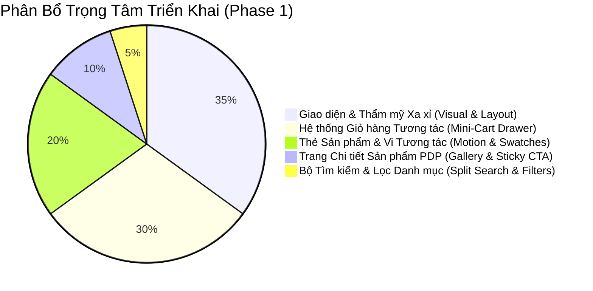

# 8. Lộ trình Triển khai Chi tiết (Implementation Roadmap & Scope)

> **Cập nhật chiến lược**: Theo chỉ đạo của Chủ dự án, **mục tiêu tiên quyết là làm website cực kỳ đẹp mắt, tinh tế chuẩn xa xỉ quốc tế (Quiet Luxury / Polène Paris / Jacquemus)** và **hoàn thiện trọn vẹn tính năng Giỏ hàng tương tác (Interactive Mini-Cart Drawer)**. Toàn bộ các tính năng Cổng thanh toán (VietQR/VNPay), Vận chuyển (GHN/GHTK), Tài khoản và Quản trị admin được dời sang các phase sau.

---

## 1. Bản đồ Phân bổ Trọng tâm Triển khai

---

## 2. PHẦN CÁC TÍNH NĂNG TRIỂN KHAI (PHASE 1: WEB ĐẸP & GIỎ HÀNG)

Dưới đây là danh mục chi tiết từng tính năng cụ thể sẽ được hiện thực hóa trong code ở Phase 1:

### 2.1. Nhóm 1: Hệ thống Giao diện & Thẩm mỹ Xa xỉ (Quiet Luxury Aesthetics)
- [ ] **Bảng màu & Design Tokens cao cấp**:
  - Tích hợp bộ màu Stone ngà cát (`#FAFAF9`), đen than (`#1C1917`), đỏ Burgundy (`#6B1530`), vàng Champagne satin (`#B99054`).
  - Hệ thống Typography 3 tầng: `Playfair Display` (tiêu đề thời trang nghệ thuật), `Inter` (giao diện và mô tả thanh lịch), `JetBrains Mono` (SKU & nhãn kỹ thuật).
  - Khoảng thở thoáng đãng, đường viền hairline siêu mảnh `1px solid rgba(28,25,23,0.08)`.
- [ ] **Header & Navigation Đẳng cấp**:
  - Thanh thông báo chạy chữ trên cùng (Announcement Top Bar).
  - Thanh điều hướng trong suốt làm mờ nền (Backdrop blur) ghim trên đỉnh khi cuộn.
  - Mega Menu đa cấp hiển thị hình ảnh Lookbook BST.
  - Menu Mobile dạng Drawer trượt mượt mà kèm hiệu ứng gập mở accordion.
- [ ] **Hero Section Nghệ thuật**:
  - Media tỉ lệ 16:9 / 21:9 hiển thị video loop ambient / Lookbook slider chuyển cảnh êm ái.
  - Tiêu đề nghệ thuật và nút Call-To-Action hiệu ứng quét viền tinh tế.
- [ ] **Khối Storytelling & Di sản Thương hiệu**:
  - Trưng bày nghệ thuật chế tác thủ công, chất liệu da thật nhập khẩu từ Ý.

### 2.2. Nhóm 2: Thẻ Sản phẩm Đẳng cấp & Vi Tương tác 60-120 FPS
- [ ] **Hiển thị độc lập từng biến thể màu sắc**:
  - Mỗi màu sắc của một mẫu túi được trưng bày thành một thẻ card riêng biệt, tôn vinh bảng màu da cao cấp.
- [ ] **Kỹ thuật Lật ảnh 2 lớp (Hover Image Cross-fade 300ms)**:
  - Khi rê chuột trên Desktop: Ảnh mặt trước mờ dần (`opacity: 0`), ảnh góc nghiêng lướt hiện (`opacity: 1`, `scale: 1.02`) mượt mà không giật layout.
- [ ] **Khung Pop-out Viền Đen khi Hover**:
  - Thẻ nhận viền đen 1px sắc nét và trượt mở khối nút **"THÊM VÀO GIỎ"** màu đen than `#27282D` đè lên không gian bên dưới (`z-index: 100`).
- [ ] **Dải Chấm màu Swatch Tương tác**:
  - Chấm tròn 18px có vòng viền bao quanh khi active. Rê chuột hoặc click vào màu nào thì ảnh card lập tức đổi sang góc chụp màu đó.
- [ ] **Lưới sản phẩm xuất hiện gợn sóng (Staggered Wave Reveal)**:
  - Khi tải danh mục, các thẻ xuất hiện so le êm ái bằng GSAP `power2.out`.

### 2.3. Nhóm 3: [TRỌNG TÂM] Hệ thống Giỏ hàng Tương tác (Interactive Mini-Cart Drawer)
- [ ] **Ngăn kéo Mini-Cart trượt từ mép phải (Slide-in Drawer)**:
  - Tự động mở khi bấm icon giỏ hàng trên Header hoặc khi bấm nút "Thêm vào giỏ" ở bất kỳ thẻ sản phẩm hay trang PDP.
  - Lớp phủ nền làm mờ màn hình (Backdrop Blur `8px`) tạo chiều sâu sang trọng.
- [ ] **Thanh Tiến trình Miễn phí Vận chuyển (Freeship Progress Meter)**:
  - Tính toán động theo thời gian thực: *"Bạn còn thiếu [X]₫ để được FREESHIP"* (mốc chuẩn: 1.000.000₫).
  - Thanh tiến trình chuyển màu từ xám sang vàng champagne lấp lánh khi người dùng đạt mốc miễn phí.
- [ ] **Quản lý Món đồ Mượt mà (Item Controls)**:
  - Hiển thị đầy đủ ảnh thumbnail sắc nét, tên mẫu túi, phân loại màu sắc/kích thước, đơn giá và giá gốc gạch ngang.
  - Bộ nút tăng giảm số lượng (+ / -) phản hồi tức thì với hiệu ứng vi mô.
  - Nút xóa món đồ với hiệu ứng trượt mờ dần (fade-out 200ms) trước khi tính toán lại tổng tiền.
- [ ] **Carousel Phụ kiện Mua kèm (In-Cart Cross-sell)**:
  - Slider mini tích hợp ngay trong giỏ hàng hiển thị các sản phẩm nhỏ (khăn lụa quấn quai túi, dây charm da, ví đựng thẻ mini).
  - Nút "+ Thêm nhanh" 1 chạm đưa ngay phụ kiện vào giỏ hàng mà không cần rời giỏ.
- [ ] **Trạng thái Giỏ hàng Trống (Empty State)**:
  - Hình minh họa túi xách tối giản thanh lịch + Thông điệp ấm áp + Nút kêu gọi "Khám phá Bộ sưu tập mới".
- [ ] **Lưu trữ Cục bộ Bền bỉ (Zustand LocalStorage Store)**:
  - Toàn bộ sản phẩm trong giỏ hàng được đồng bộ tự động vào bộ nhớ trình duyệt, không bao giờ bị mất dữ liệu khi người dùng làm mới trang (F5).
- [ ] **Giao diện Chốt giỏ (Mock Checkout CTA)**:
  - Hiển thị tổng tiền tạm tính, nút "Tiến hành Đặt hàng" thiết kế sang trọng chuẩn bị cho giai đoạn kết nối thanh toán sau.

### 2.4. Nhóm 4: Bộ Tìm kiếm Chia đôi Màn hình (Split Mega-Search Drawer)
- [ ] **Drawer trượt ngang từ mép trái** khi bấm icon kính lúp trên Header.
- [ ] **Cột trái (610px)**:
  - Thanh tìm kiếm gạch chân dưới tối giản.
  - Gợi ý sản phẩm trực tiếp (Live AJAX Autocomplete hiển thị ảnh thumb + tên + giá đỏ) ngay khi gõ từ khóa.
  - Menu duyệt nhanh các từ khóa xu hướng & danh mục nổi bật.
- [ ] **Cột phải (430px)**:
  - Nút đóng X cố định góc trên.
  - Khối bài viết Tạp chí & Xu hướng mới nhất truyền cảm hứng thời trang và phong cách phối đồ.

### 2.5. Nhóm 5: Trang Chi tiết Sản phẩm Tương tác (Interactive PDP)
- [ ] **Gallery ảnh chất lượng cao**: Slider vuốt chạm đa góc chụp, zoom chi tiết vân da và khóa kéo kim loại.
- [ ] **Bộ chọn Biến thể Màu sắc & Kích thước**: Đồng bộ hiển thị tồn kho và trạng thái đang chọn.
- [ ] **Accordion Thông số & Chính sách**: Trượt mở mượt mà (300ms) với icon mũi tên xoay 90 độ, tự động thu gọn các mục còn lại.
- [ ] **Thanh Ghim Đáy Màn hình (Sticky Add-to-Cart Bar)**: Tự động xuất hiện khi cuộn qua nút mua chính, đồng bộ trạng thái 2 chiều với form trên.

---

## 3. DANH MỤC CÁC TÍNH NĂNG TẠM HOÃN CHO CÁC PHASE SAU

Nhằm đảm bảo 100% thời gian và năng lực tập trung vào chất lượng giao diện và trải nghiệm giỏ hàng, các tính năng sau đây được lên lịch thực hiện ở các giai đoạn tiếp theo:

| Phân hệ chức năng | Chi tiết tính năng tạm hoãn | Kế hoạch triển khai |
|---|---|:---:|
| **1. Cổng Thanh toán (Payment Gateways)** | - Tích hợp VietQR tự động qua PayOS - Cổng thanh toán thẻ ATM / Visa qua VNPay / MoMo - Xử lý Webhook xác thực giao dịch chuyển khoản | **Phase 2** (Sau khi hoàn tất giao diện & giỏ hàng) |
| **2. Vận chuyển & Kho bãi (Logistics)** | - Kết nối API bưu cục Giao Hàng Nhanh (GHN) / GHTK - Tự động tính cước vận chuyển theo Tỉnh/Huyện/Xã - Tạo vận đơn và tra cứu mã đơn hàng theo thời gian thực | **Phase 2** |
| **3. Tài khoản Khách hàng (User Auth)** | - Đăng ký, đăng nhập OTP qua SMS / Zalo - Sổ địa chỉ giao hàng cá nhân - Lịch sử đơn hàng và tích điểm thành viên thân thiết | **Phase 3** |
| **4. Quản trị & Vận hành (Admin CMS)** | - Dashboard thống kê doanh thu, quản lý xuất nhập tồn - Quản lý danh mục sản phẩm, biến thể kho hàng - Quản lý mã giảm giá coupon nâng cao | **Phase 3** |
| **5. Đồng bộ Showroom Động** | - Bản đồ mạng lưới showroom thực tế - Kiểm tra số lượng tồn kho theo từng địa chỉ cửa hàng | **Phase 3** |

---

## 4. Kế hoạch Triển khai Thực thi (Sprint Plan)

* **Sprint 1 — Khởi tạo Nền tảng & Hệ thống Design System**:
  - Khởi tạo dự án Next.js 15 App Router, TypeScript, Tailwind CSS v4, `@phosphor-icons/react`, `gsap`, `zustand`.
  - Cấu hình font chữ Google (`Playfair Display`, `Inter`, `JetBrains Mono`) và biến CSS màu sắc Quiet Luxury trong `app/globals.css`.
  - Dựng khung `Header` (Top bar, Mega menu) và `Footer` thời trang.
* **Sprint 2 — Thẻ Sản phẩm & Mega Search**:
  - Xây dựng bộ Mock Data 24 mẫu túi xách cao cấp đầy đủ góc chụp và biến thể màu sắc.
  - Dựng thẻ sản phẩm `ProductCard`: Lật ảnh khi hover 300ms, pop-out viền đen, dải chấm màu swatch tương tác.
  - Dựng drawer tìm kiếm 2 cột `SearchDrawer`.
* **Sprint 3 — [TRỌNG TÂM] Mini-Cart Drawer & PDP**:
  - Dựng Zustand Cart Store kết nối LocalStorage.
  - Dựng Mini-Cart Drawer: thanh tiến trình Freeship realtime, tăng giảm số lượng, xóa món đồ, carousel gợi ý mua kèm phụ kiện.
  - Dựng Trang chi tiết sản phẩm `PDP` kèm thanh `Sticky Add-to-cart Bar`.
* **Sprint 4 — Tinh chỉnh & Tối ưu Trải nghiệm (Polish & 60-120 FPS)**:
  - Kiểm thử chuyển động mượt mà trên iPhone/Android và máy tính bàn.
  - Tối ưu GPU Compositor và đạt điểm Core Web Vitals 95+.
