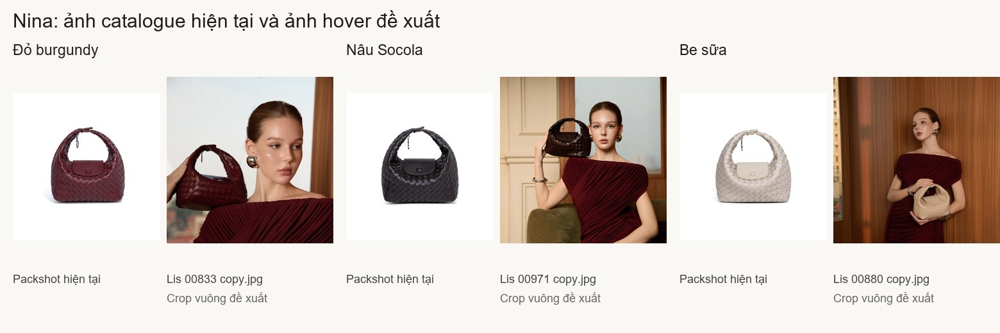
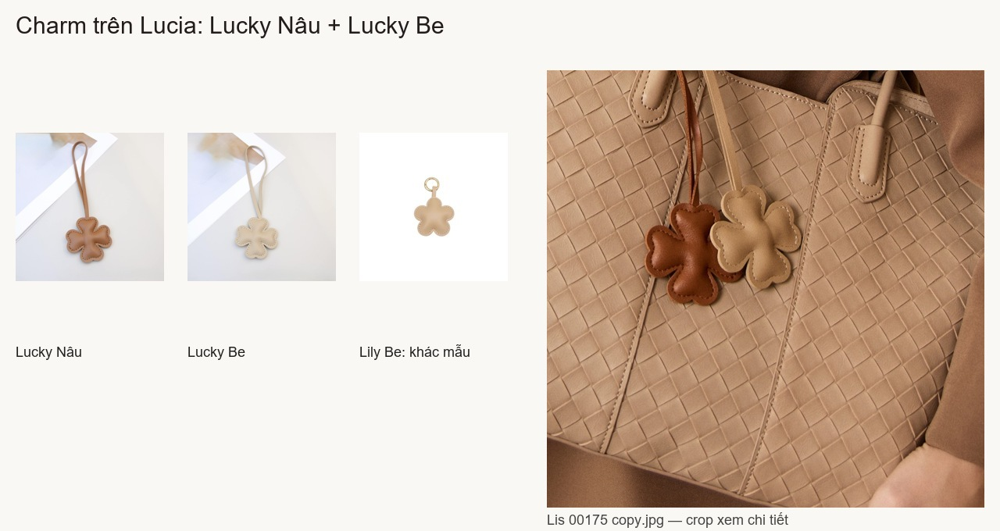

# Rà ảnh photoshoot LIS — 10/10/2026

Đã xem trực tiếp toàn bộ **35 ảnh** trong `PTS Lis Bag/` và đối chiếu với ảnh của 25 biến thể gốc. Báo cáo chỉ chọn ảnh; catalog vẫn là bản 62 ảnh đã khôi phục. Việc nhận diện dựa trên phom, quai, nắp, đường đan và màu nhìn thấy; bộ ảnh không có mã SKU/màu để xác nhận bằng metadata.

## Có thể bổ sung hover ngay theo thiết kế packshot → lifestyle

| Mẫu / màu | Ảnh ưu tiên | Ảnh bổ sung | Ghi chú |
|---|---|---|---|
| Nina / Đỏ burgundy | `Lis 00833 copy.jpg` | `Lis 00855 copy.jpg` | 00833 cầm túi cạnh mặt, không phải kẹp nách như script ghi. Crop vuông ưu tiên phần trên để giữ túi. |
| Nina / Nâu Socola | `Lis 00971 copy.jpg` | `Lis 00896 copy.jpg` | 00971 giữ được túi và mặt người mẫu khi crop vuông. 00896 hợp gallery; crop vuông dễ cắt đầu hoặc đáy túi. Màu tối chịu ánh sáng ấm; đối chiếu bằng cặp preview. |
| Nina / Be sữa | `Lis 00880 copy.jpg` | `Lis 00807 copy.jpg`, `Lis 00860 copy.jpg`, `Lis 01033 copy.jpg` | 00880 tập trung một túi, tốt hơn ảnh nhiều màu 01072. |

Preview crop chỉ dành cho xét chọn, chưa đưa lên website. Với ảnh dọc, crop mặc định bám đáy có thể cắt phần túi/đầu; cần chốt crop riêng trước khi import.

## Lucky Charm: có ảnh phối túi để cân nhắc

`Lis 00175 copy.jpg` và `Lis 00203 copy.jpg` chụp **Lucky Nâu và Lucky Be** treo trên Lucia Be sữa. Hai charm có bốn nhánh hình cỏ và dây dài; **không phải Lily** năm cánh với khoen kim loại. Script cũ chú thích Lily là sai.

Có thể crop cận để làm ảnh phối túi cho Lucky, nhưng hai màu sát/đè lên nhau. Đây là ứng viên cần kiểm khung crop, không tính là hai hover đã hoàn thiện. Ưu tiên chụp mỗi màu riêng nếu muốn card rõ nhất.

## Mila, Elena, Lucia: đủ thêm ảnh nhưng chưa có packshot

| Mẫu / màu | Ảnh mới nên thêm | Ảnh lớn cùng góc hiện tại nên dùng để nâng chất lượng |
|---|---|---|
| Lucia / Nâu Socola | 00119, 00112, 00292 | 00127 |
| Lucia / Be sữa | 00175, 00203, 00185 | 00334 |
| Lucia / Nâu đất | Bộ này chưa thêm góc riêng tốt hơn | 00237 |
| Elena / Đen | 00436(2), 00419 copy 2 | 00456 |
| Elena / Nâu | 00479 | 00505 |
| Mila / Be sữa | 00898 | 00532 |
| Mila / Nâu đất | 00571 | 00603 |
| Mila / Đỏ đô | 00717(2), 00672, 00706, 01015 | 00639 |

Số trong bảng là mã nằm trong tên `Lis … copy.jpg`. Tám ảnh ở cột cuối là ảnh lớn cùng góc đã có: thay ảnh cũ bằng bản lớn, không thêm thành góc trùng. Toàn bộ bộ mới là ảnh người mẫu; **không có ảnh túi chụp riêng trên nền trơn**. Cả 8 biến thể nhóm B vẫn cần packshot để đạt thiết kế catalogue → hover đã chốt. Crop người ra khỏi ảnh không tự tạo ra một packshot đầy đủ, nhất là khi tay hoặc cơ thể che túi.

Ảnh `00284` (nhiều Lucia), `00551` (hai Mila), `01053` (Mila + Nina nhiều màu) và `01072` (nhiều Nina) hợp editorial/bộ sưu tập, không chọn làm hover một màu. Hai file 00284 và 01053 chưa được dùng trong script trước đó.

## Phần còn thiếu

- Mia: cả 4 màu chưa có ảnh mẫu đeo trong bộ này.
- Calla: cả 3 màu chưa có ảnh mẫu đeo trong bộ này.
- Lucia Đen: chưa tìm thấy ảnh người mẫu chắc chắn cùng màu Đen; ảnh tote tối trong bộ này đối chiếu với Lucia Nâu Socola.
- Lily: chưa thấy đúng charm hoa năm cánh/khoen kim loại.
- Lucky Đỏ: chưa thấy ảnh phối túi cùng màu.
- Nhóm B: 8 biến thể vẫn thiếu packshot.

Có **3/25 biến thể gốc** đủ ảnh để bổ sung hover theo chuẩn hiện tại. Nếu crop Lucky Nâu/Be đạt yêu cầu, có thể lên **5/25**. Tệp [selection.json](source-audit/photoshoot-review/selection.json) ghi vai trò và biến thể ứng viên cho đủ 35 ảnh. Khi triển khai, thêm từng ảnh đã kiểm vào đúng màu và chạy `scripts/sync-product-images.mjs`; không dùng lại ánh xạ và phân loại ép packshot của script cũ.
